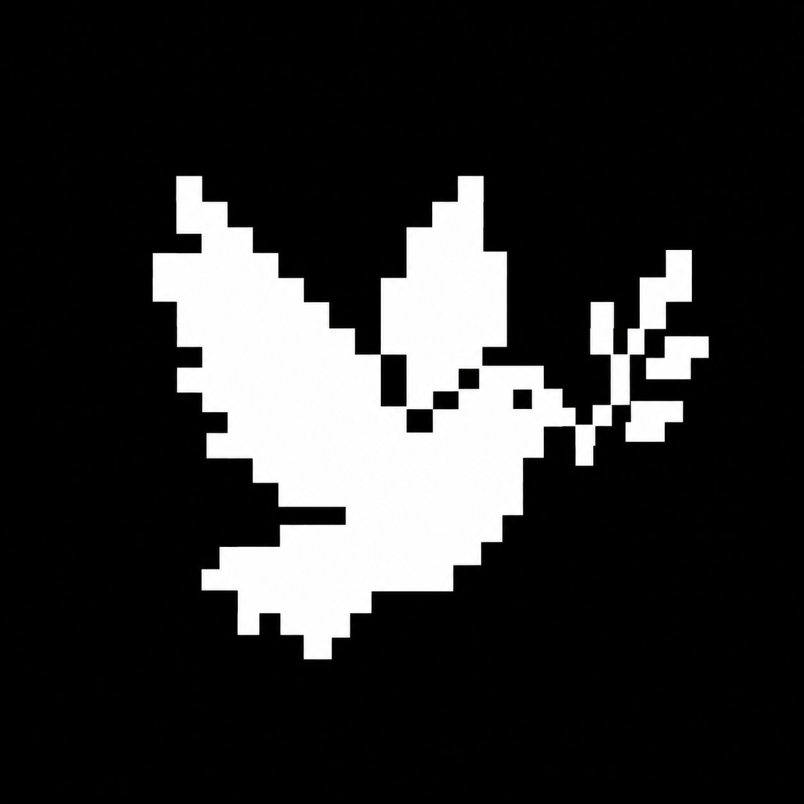

# Dove



Dove helps move research forward: inspect sources, design methods, run experiments, interpret evidence, write papers, create figures, review the work and respond to criticism.

The main session owns the user conversation, execution and delivery. An isolated mentor judges direction rather than engineering. Work is scaled to answer the question, not to make the smallest possible change. Ordinary questions and bounded tasks retain their scope.

## Start

Install an exact trusted artifact, then initialize the project:

```bash
npm install --global <exact-dove-package-specifier>
cd <target-project>
dove
```

The bare public npm name `dove` is unrelated. Global upgrades with lifecycle scripts enabled refresh registered projects, never an arbitrary directory scan. Import older projects with `dove projects import --project <root>... --sync`; inspect `dove projects status`. Bulk sync preserves local owned edits while updating the rest; explicit `dove update` may replace valid owned edits. Research history is preserved. See [Installation](docs/INSTALL.md).

## Ordinary conversation first

Start ordinary `claude` in the initialized project. The project rule provides the complete primary entrance; `claude --agent dove` and nine flat Skills are optional shortcuts, not personas, stages or permissions. DSH receives filesystem Skills and shared references, not Claude agents or hooks. There is no Auto command.

| Skill | Use it for |
|---|---|
| `dove.research` | Explore parallel candidates for the user's choice, or advance a confirmed mainline. |
| `dove.status` | Report results, core evidence, blockers and current round without new work. |
| `dove.source` | Discover and inspect sources, verify citation identity and check claims. |
| `dove.experiment` | Develop, evaluate and analyze methods through fair comparisons. |
| `dove.draft` | Write evidence-grounded text and inspect the authoritative build/export. |
| `dove.figure` | Gather materials, create and inspect visuals, and deliver captions and editable sources. |
| `dove.review` | Distinguish author self-check, delivery checks and independent current-paper review. |
| `dove.rebuttal` | Verify review concerns, respond and make requested revisions. |
| `dove.lessons` | Read or preserve grounded transferable advice. |

Each fresh author main context personally reads the short Chinese quality and preference essentials; full companions are on demand. Installation and hooks do not prove reading or application.

## Research direction and records

Before mainline choice, read project standards. Find gaps on distinct challenge axes from full-text near misses, then search other subfields for transferable mechanisms. Parallel candidate cards name the gap, source, mapping, assumptions, closest-work difference and risk. Active counter-search yields keep, revise one weakness, or reject with evidence. Offer 2–3 recommendations for the user's choice; before it, only standards-allowed diagnostics, not method implementation. Confirmed mainlines are not reopened on takeover.

Researcher-owned Markdown under `.dove/research/` keeps current context short:

- **`IDENTITY.md`** holds the mainline, core capability with the user's words, target tier, completion, sourced restrictions and current research state in readable fixed fields.
- **`EVAL.md`** has one row per method version and seven columns, with numbers and plain-language conclusions linking to details. The executor repairs evaluation and recomputes comparable history. The mentor's current eight-dimensional assessment replaces the previous one below the table.
- **`rounds/`** has one authored brief and one result per round, linking ordinary artifacts. Both use natural Chinese full sentences: the brief explains expected outcomes, and the result compares them with actual measurements and records changes and factual objections.
- **`MENTOR_NOTES.md`** holds the mentor's own memory; consolidation preserves the latest long-term intent comparison and its date, along with issues already raised and their answers. Dated impacts and scans live in `watch/`; `papers/` keeps cumulative full-text Q&A and a direction-grouped JSON/Markdown library with Chinese takeaways and BibTeX export. The dashboard shows core capability beneath the mainline and the latest long-term intent comparison with its date in a collapsed section.

Existing missions, experiments and claims stay in place without migration or new entries. `RESEARCH.md` is a short history index; init creates only that bootstrap when the research tree is absent. Lifecycle operations preserve research. Optional `dove settings --host-migration on` registers upgrade tasks for the host to finish after current work, not a CLI rewrite; default is off. Status and bounded replies need no round.

## Mentor and independent paper review

Call the mentor at round end, after two no-science rounds, when the user corrects direction or questions the paper story, before route changes or when requested. Engineering and verification failures count; ask the user before further continuation by the third no-result round. Route changes name the old route, new route and reason.

Use `dove mentor brief --project <root>` as the call body plus its trigger. Its five questions cover direction against the user's words and core capability, general capability versus patches, remaining gaps, next work, and contribution against the closest prior work at the target tier. Executor opinions belong in an attributed file; length or a missing signature does not block the call. Each cross-round judgment uses a fresh context and the mentor's own notes, not resumed execution conversation. Engineering, parameters and evaluator repairs remain the executor's responsibility; the mentor may retrieve sources but does not execute or edit.

The generated `.dove/install/USER_ORIGINALS.md` distinguishes the user's own words from relays. Check recorded “user wording” or “user confirmation” against it; incomplete coverage is not evidence the user never said something, so consult the original session or current direct words when needed. Collection currently covers Claude Code, not DSH. The resident dashboard prewarms it for every registered project in the daily paper-watch schedule, even when that project's tracking is disabled, using the existing scan budget. When mentor notes have no dated long-term intent section or its date is strictly more than seven days old, the mentor compares long-term intent, core capability and the actual work, then returns a dated section. Raise conclusions needing a user decision once without blocking work.

Every mentor checks tracking, unjudged papers and overdue scans independently of rounds. For draft or off-target tracking, the main session saves the mentor's actual suggested JSON fields to a file and runs `dove watch configure --project <root> --mentor <建议.json> [--json]`. Only suggested fields are replaced; `enabled`, `categories` and other settings remain. Check the receipt's saved values and `source: mentor`, which records actual saved advice, not user confirmation of research direction. Without advice, keep the draft.

Independent `dove-review` uses only Read/Grep/Glob on the specified complete current manuscript, cited results and supplied grounding. It receives no author conversation or preferences, does not retrieve, execute or edit, and lists what it read. No frozen copy, hashes or external workspace is required. Author self-check is not independent review; submission completion needs scientific sufficiency, current independent review and actual delivery readiness. Software checks do not certify scientific correctness or acceptance.

## Run receipts

For authorized local work, optional `dove run start [--seed <short text>] -- <command> [args...]` directly launches a command without a shell and records timing, outcome, metric/comparison basis and minimum seed/Git facts. Status is read-only; resume never reruns; finalize adds a scalar after completion; compare ranks compatible finalized runs. Receipts are execution facts, not scientific conclusions.

## License

Dove is licensed under the [PolyForm Noncommercial License 1.0.0](LICENSE) only for purposes that license permits. It is source-available, not OSI-approved open-source software; no commercial-license path is offered. Bundled third-party components retain their MIT/ISC terms; see [Third-Party Notices](THIRD_PARTY_NOTICES.md).

## Documentation

- [Installation](docs/INSTALL.md)
- [Usage](docs/USAGE.md)
- [Capability matrix](docs/CAPABILITY_MATRIX.md)
- [Output samples](docs/DOVE_COMMAND_OUTPUT_SAMPLES.md)
- [Packaging](docs/PACKAGING.md)
- [Development docs](docs/development/README.md)
