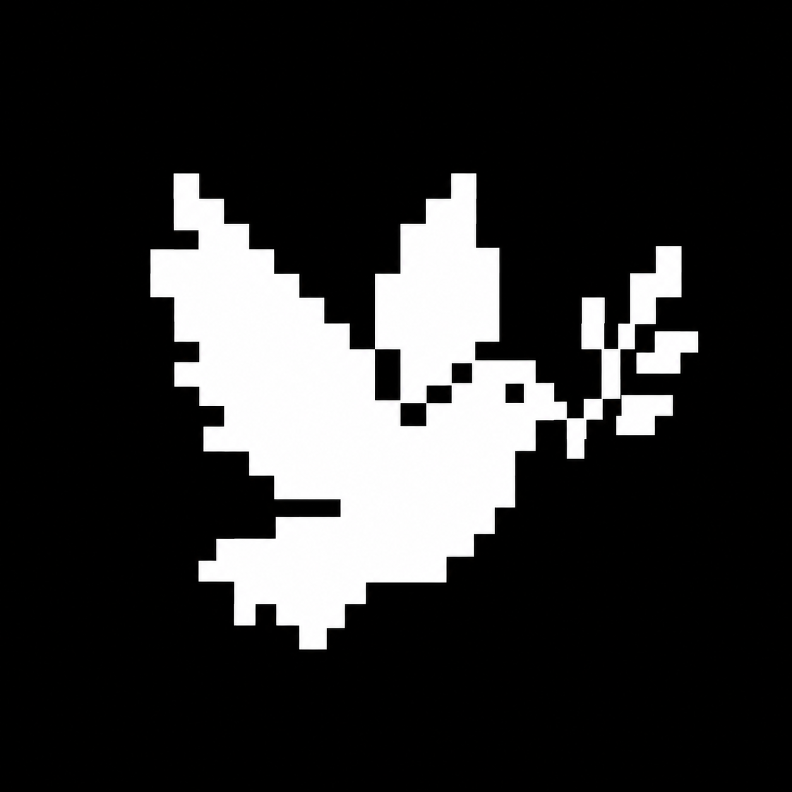

# Dove



Dove is a research partner layer installed in each research project. It lets the model in Claude Code push the research forward on its own while the user only corrects course now and then.

Dove does not think for the model. It does three things:

1. At the right moments it puts the right questions and facts in front of the model.
2. What the model does poorly by itself, Dove computes or asks on the user's behalf.
3. Decisions that are genuinely the user's go to the user, in a form readable at a glance.

The user decides three kinds of things: the mainline and its main metric; new method designs; and, on an overrun or a stall, whether to continue, change the method or change direction. The host stops only for those, for an overrun or stall, or when the user says stop — never just to write a report. The independent mentor judges at decision points and raises questions instead of rubber-stamping.

## Start

Install an exact trusted artifact, then initialize the project:

```bash
npm install --global <exact-dove-package-specifier>
cd <target-project>
dove
```

The bare public npm name `dove` is unrelated. Global upgrades with lifecycle scripts enabled refresh registered projects, never an arbitrary directory scan. Import older projects with `dove projects import --project <root>... --sync`; inspect `dove projects status`. Bulk sync preserves local owned edits while updating the rest; explicit `dove update` may replace valid owned edits. Research history is preserved. See [Installation](docs/INSTALL.md).

## What the host reads, and when

| When | What |
|---|---|
| Session start | The operating manual (`.claude/rules/dove.md`, the one place operating rules live) and "the user's most frequent sayings" (`.dove/install/AUTHOR_PREFERENCES.md`: twelve verbatim quotes with dates, each followed by what to do) |
| Every user message | The identity card; this round's one-line aim, the dimension it targets, how it counts as done, its scale and due date; what waits for the user; once after an update, a notice to re-read the manual and the sayings |
| After compaction | The same, plus the user's latest own words |
| At the moments the manual names | The matching section of the research standard (`.dove/install/RESEARCH_QUALITY.md`) |
| Topic selection | The topic-selection standard |

Ordinary `claude` in the initialized project is the primary entrance. `claude --agent dove` and seven flat Skills are optional shortcuts:

| Skill | Use it for |
|---|---|
| `dove.research` | Offer grounded candidates for the user's choice, or advance a confirmed mainline. |
| `dove.status` | Report real results, the main metric, the current round and blockers without new work. |
| `dove.source` | Discover and read sources, verify citations and check claims. |
| `dove.experiment` | Develop and evaluate methods through fair comparisons. |
| `dove.draft` | Write and revise the authoritative manuscript, including responses to reviews. |
| `dove.figure` | Design, draw, inspect and deliver figures. |
| `dove.review` | Independent current-paper review, a cold read of the compiled PDF by a first-time reader, author self-check or delivery check. |

## Records

Researcher-owned Markdown under `.dove/research/`:

- **`IDENTITY.md`** — mainline, research state (written by the mentor), method design pointer, core capability with the user's words, target tier, completion, sourced restrictions.
- **`rounds/NNN-brief.md`** opens with `Author:`, `对准：<dimension>`, `见分晓：YYYY-MM-DD（开始：YYYY-MM-DD）` and `规模：…`; a new method adds the three-part method design and the user's reply. **`NNN-result.md`** opens with `判定：兑现 / 未兑现 / 方法取舍（…）`, judged only against the brief.
- **`EVAL.md`** opens with `主指标：<name>（<data and protocol>）；当前最好：<value>（<date>，第 N 轮）`, then the eight-dimension trend table (one row per mentor judgment, ending with the dimension most holding the work back) and the method-version table whose rows link result files.
- **`MENTOR_NOTES.md`** — the mentor's own memory, including rejected method families, `可迁移：` lessons and `### 待用户决定`.

Old rounds, conclusions and user words are never rewritten.

## What Dove computes

From those records Dove computes, without asking the host: the current round's aim, due date and scale; each verdict; overrun (the due date passed by as long again as the plan); stall (two consecutive missed verdicts with no method decision); the main metric and trend; what waits for the user; and per-week subagent calls and compactions from the session transcripts. These feed the per-message context, the three-line status line, the mentor handoff (`dove mentor brief`) and the dashboard.

When the host ends a turn on an overrun or a stall, the Stop hook quotes the user's own words once per condition — 10-11 for an overrun, 10-23 ("先整理一下……") for a stall — labeled as Dove quoting the user, never while the host is already answering it. `dove settings --stop-prompts off` turns this off.

## Mentor and independent review

The mentor (`dove-mentor`, a fresh read-only native agent) is called when a round has a verdict, on an overrun or stall, for a new method design and when the user asks. It first answers three questions (what substantive progress, whether recent work tested the method or built infrastructure, what is left and whether there is a faster path), then checks the verdict, updates the eight-dimension judgment, writes the next brief and the plain-language research state, and keeps its notes. Paper-watch judgments happen weekly or on request; the long-term intent comparison comes due every three rounds or after a method decision.

Independent `dove-review` reads only the specified complete current manuscript, cited results and supplied grounding through Read/Grep/Glob.

## Dashboard

`dove dashboard` shows each project's mainline, main metric, eight-dimension trend, each round's aim, verdict and scale, overrun and stall flags, activity against results and what waits for the user; plus a cross-project page of mentors' transferable lessons (also written into each project as `.dove/install/CROSS_PROJECT_EXPERIENCE.md`) and a page of the user's recurring corrections by topic.

## License

Dove is licensed under the [PolyForm Noncommercial License 1.0.0](LICENSE) only for purposes that license permits. It is source-available, not OSI-approved open-source software; no commercial-license path is offered. Bundled third-party components retain their MIT/ISC terms; see [Third-Party Notices](THIRD_PARTY_NOTICES.md).

## Documentation

- [Installation](docs/INSTALL.md)
- [Usage](docs/USAGE.md)
- [Capability matrix](docs/CAPABILITY_MATRIX.md)
- [Output samples](docs/DOVE_COMMAND_OUTPUT_SAMPLES.md)
- [Packaging](docs/PACKAGING.md)
- [Development docs](docs/development/README.md)
