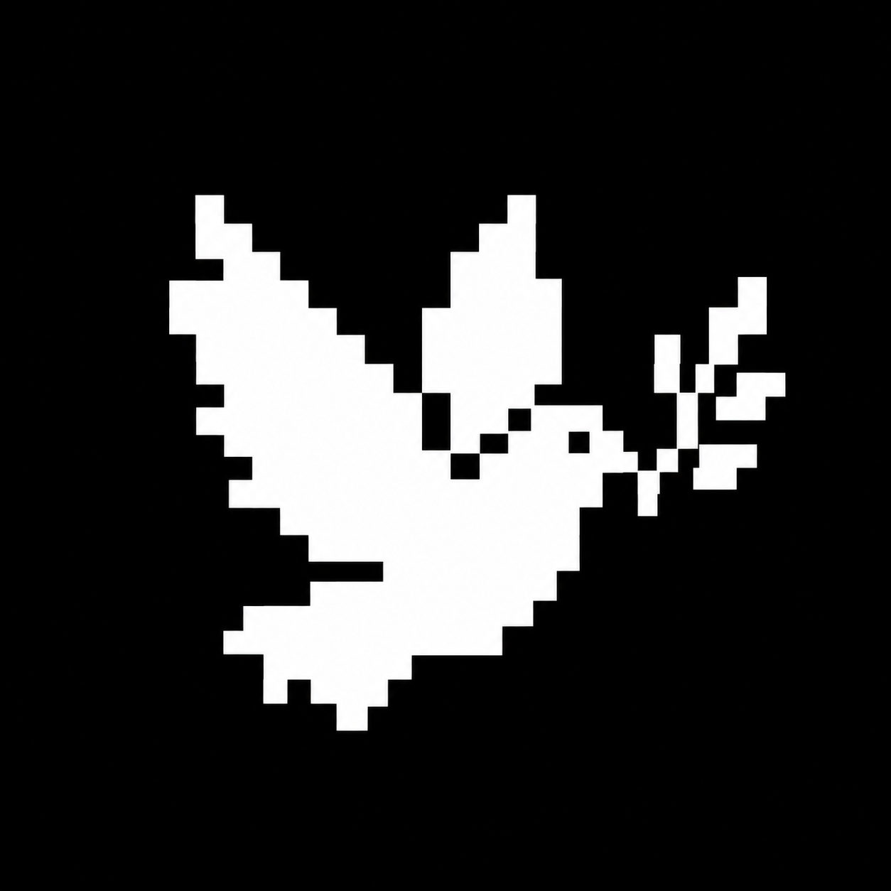

# Dove documentation

Dove is one research partner. Ordinary Claude conversation in an initialized project is its primary entrance; `claude --agent dove` and seven flat Skills are optional. The host pushes the research forward and stops only for the user's decisions, an overrun or stall, or the user saying stop; a fresh read-only mentor judges at decision points.

## Guides

- [Installation](INSTALL.md) owns trusted package installation, Claude Code setup, hooks, permissions, managed-file ownership, lifecycle operations and Doctor.
- [Usage](USAGE.md) owns the six moments of a round, the records, what Dove computes, the mentor, independent review, the dashboard and topic selection.
- [Capability matrix](CAPABILITY_MATRIX.md) summarizes the seven Skills and what each surface provides.
- [Output samples](DOVE_COMMAND_OUTPUT_SAMPLES.md) shows output shapes without imposing response templates.
- [Packaging](PACKAGING.md) owns source-to-resource relationships, package inventory and release checks.
- [Author preferences](AUTHOR_PREFERENCES.md) is the sole editable source for the user's full cross-project preferences, installed unchanged as `AUTHOR_PREFERENCES_FULL.md`. The installed `AUTHOR_PREFERENCES.md` is "the user's most frequent sayings", generated from `src/core/dove-author-preferences.mjs`.
- [Development docs](development/README.md) index Dove's design notes; the current design is [the 3.5.0 overhaul](development/OVERHAUL_3_5_0.md).

## Keep these boundaries clear

- The operating manual is the only place operating rules are written; Skills carry only their own practice; the research standard is a reference for the mentor, the reviewer and the moments the manual names.
- Research records are the identity card, `EVAL.md`, round briefs/results and mentor notes. Historical `missions/`, `experiments/` and `claims/` stay in place. Lifecycle operations preserve researcher-owned files and never rewrite old rounds.
- The main metric shows progress; it is not a gate. A verdict is judged only against what the brief wrote in advance.
- `dove-mentor` and `dove-review` are fresh native Claude contexts limited to reading specified materials. Self-check is not independent review.
- Requested-work completion, scientific progress and [software verification evidence](PACKAGING.md#verification-evidence) remain separate claims.
